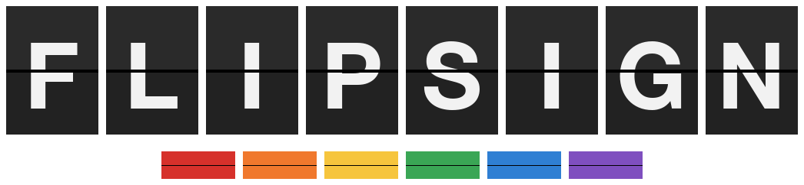
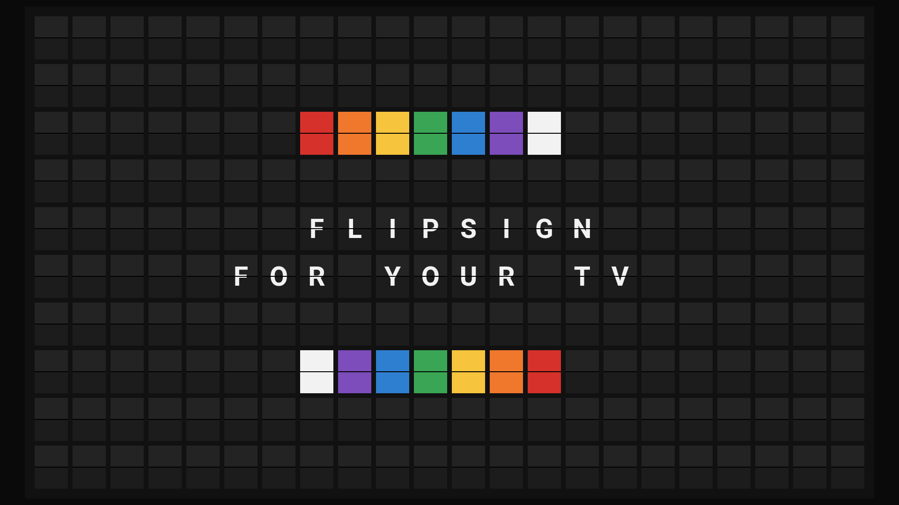
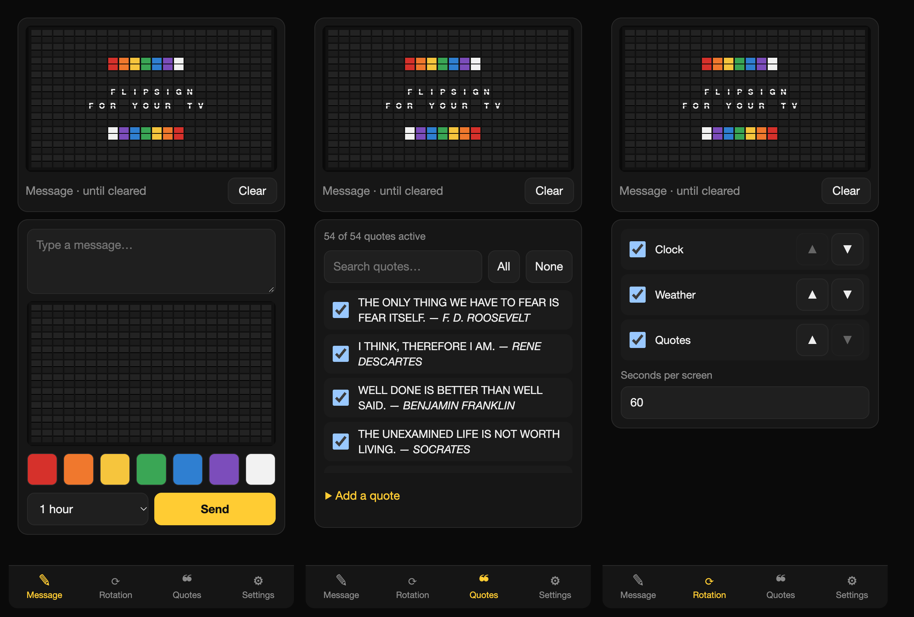
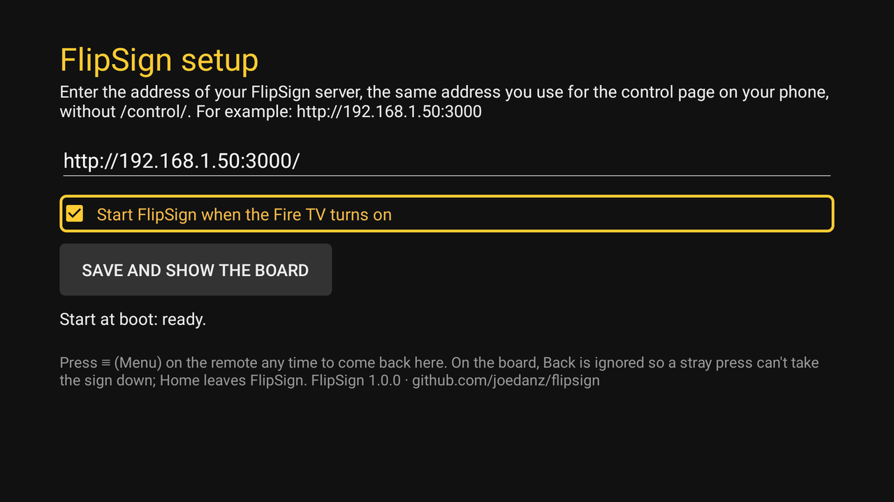

<h1 align="center"></h1>

A full-screen split-flap display for your TV: a 22-column board of flaps with six lines for text. A small Node server decides what the board says (a clock, the weather forecast, quotes, or a message you send from your phone), and a full-screen web page animates the flips, clack and all.



It runs as two pieces: a **server** on any always-on machine with Node 22+ (a Mac mini, a Raspberry Pi, a NAS…), and a **display**, which is just a web page. Show it on a TV with the included [Fire TV app](#fire-tv-app), or with any computer or device that has a browser.

## Features

- **Rotating screens:** clock, 3-day weather forecast ([Open-Meteo](https://open-meteo.com/), no API key), and a deck of 50+ built-in quotes you can switch on and off or add to.
- **Send a message from your phone:** with coloured tiles, for 15 minutes, an hour, four hours, until cleared, or added to the rotation.
- **Phone-friendly control page** with a live preview of the board, rotation order, quote management and settings (temperature unit, 12/24-hour clock, flip speed, sound).
- **Real flip animation** on a single canvas, with a generated "clack" sound. Fast enough for a Fire Stick.
- **Fire TV app** that shows the board full screen, keeps the screen awake and starts at boot.
- **No build services, no database, no account.** One process, one JSON file.



## Quick start

Requires Node 22 or newer.

```bash
git clone <this repo> && cd flipsign
npm install
npm run build
npm start
```

- Display: <http://localhost:3000/> (press F11 for full screen)
- Control page: <http://localhost:3000/control/>

Open the control page on your phone using the server's address on your network, e.g. `http://192.168.1.50:3000/control/`, and use "Add to Home Screen" for an app-like icon.

### Configuration

| Variable | Default | |
| --- | --- | --- |
| `PORT` | `3000` | HTTP port |
| `FLIPSIGN_DATA` | `./data/state.json` | Where settings, rotation and your quotes are saved |

Display URL options: `?debug` shows an FPS overlay, `?instant` skips the flip animation.

## Running the server

On macOS, `deploy/install.sh` builds the project and installs it as a launchd agent that starts at login and restarts if it crashes (logs in `~/Library/Logs/flipsign/`). Set the machine not to sleep, and to start up after a power failure. With FileVault on, a Mac only runs login items after someone has logged in, so after a power cut the board stays dark until you log in once.

On other platforms, run `npm start` under your process manager of choice (systemd, pm2, Docker…). Scripts for those are welcome contributions.

Give the server a fixed address (a DHCP reservation in your router) so the display and your phone can always find it.

## Choosing a display

The display is a web page at `http://<server>:3000/`, so anything that can show a full-screen browser works:

- **A Fire TV Stick (what this was built for).** It costs about $30–50, plugs straight into the TV's HDMI port, hides behind the TV, comes with a remote, and draws a few watts, so it can stay on all the time. Its built-in Silk browser shows browser bars and is too slow for the flip animation, so FlipSign includes a small [Fire TV app](#fire-tv-app) that shows the board full screen, keeps the screen awake, and starts on its own when the stick powers on.
- **A Mac mini or any other computer connected to the TV.** Open the URL in Chrome, Safari or Firefox and go full screen (F11, or Ctrl/Cmd+Shift+F). Prevent sleep and screensavers. If the server already runs on a Mac mini behind the TV, it can be the display too: open `http://localhost:3000/` on it.
- **A Raspberry Pi** running Chromium in kiosk mode (`chromium-browser --kiosk http://<server>:3000/`).
- **A smart-TV browser, a spare tablet or an old laptop.** Anything with a modern browser. Pick the one with the fastest graphics; add `?debug` to the URL to see the frame rate while the board flips (aim for 30+ FPS).

## Fire TV app

The app is a small, open-source WebView wrapper (source in [`firetv/`](firetv/)). It supports Fire TV devices running Fire OS 6 or newer and has been tested on a Fire TV Stick 4K (2nd gen, Fire OS 8.1). Reports from other models are welcome.

### Install

1. **Allow installing apps.** On the Fire TV: Settings → My Fire TV → About, then select the name of your device (e.g. "Fire TV Stick 4K") seven times until it says you are a developer.
2. Install **Downloader** (by AFTVnews) from the Amazon Appstore. Then Settings → My Fire TV → Developer options → Install unknown apps, and turn it on for Downloader. (If Downloader isn't listed, run Settings → My Fire TV → About → Check for updates first; some Fire OS 8.1 builds hid it.)
3. Open Downloader and enter:
   `https://github.com/joedanz/flipsign/releases/latest/download/flipsign-firetv.apk`
   Choose Install when the download finishes, then Done. Downloader offers to delete the APK file afterwards, which is fine.
4. Open **FlipSign** from Your Apps & Channels. New apps go at the end of the row; press ≡ (Menu) on it and choose Move to front if you like.

### First run

FlipSign asks for your server's address, the same one you use for the control page, without `/control/`, e.g. `http://192.168.1.50:3000`. It checks that a FlipSign server answers there, then shows the board.



Remote control on the board:

| Button | Does |
| --- | --- |
| ≡ (Menu) | Opens setup: change the server address, start at boot |
| Back | Nothing, so a stray press can't take the sign down |
| Home | Leaves FlipSign (the board keeps running on the server) |

If the server is unreachable, the app says so and retries every 10 seconds on its own.

### Keep it on screen

- **Screensaver and sleep:** the app keeps the screen awake while it is showing, so the Fire TV screensaver won't cover the board. Turning the TV off and on is fine; the board picks up where it is.
- **"Still watching?":** Fire OS asks this after about 4 hours without a button press and then goes back to Home. Turn it off in Settings → Preferences → Data Usage Monitoring → Still Watching, or choose "Don't show again" the first time it appears.
- **Parental controls:** if "PIN Protect App Launches" is on (Settings → Preferences → Parental Controls), the Fire TV asks for your PIN every time FlipSign opens, including at boot. Turn that switch off if you want the board to come up by itself.

### Start at boot

To have the board come up by itself after a power cut, the app needs Android's "display over other apps" permission. Fire TV has no on-screen switch for it, so grant it once from a computer on the same network:

1. On the Fire TV: Settings → My Fire TV → Developer options → **ADB debugging** on. Note the IP address under Settings → My Fire TV → About → Network.
2. On a computer with [Android platform-tools](https://developer.android.com/tools/releases/platform-tools) installed (`brew install android-platform-tools` on a Mac):
   ```bash
   adb connect <fire-tv-ip>        # accept the prompt on the TV
   adb shell appops set io.github.joedanz.flipsign SYSTEM_ALERT_WINDOW allow
   ```
3. Turn ADB debugging off again. Press ≡ in FlipSign: setup should say "Start at boot: ready".

After a restart, Fire OS shows its Home screen first and only tells apps it has started a minute or two later, so expect the board about 2–3 minutes after power-on.

You can switch start at boot off in setup at any time.

### Update and uninstall

To update, repeat step 3 of Install; your settings are kept. To uninstall: Settings → Applications → Manage Installed Applications → FlipSign → Uninstall.

Other ways to run the display on a Fire TV (Fully Kiosk Browser) and troubleshooting are in [docs/firestick-setup.md](docs/firestick-setup.md).

## Security

**There is no login.** Anyone who can reach the server's port can change the board. Keep it on your home network, or put it behind a VPN such as [Tailscale](https://tailscale.com/) if you want access away from home. Don't forward the port to the internet. See [SECURITY.md](SECURITY.md).

## How it works

The server computes the text grid, 6 rows by 22 columns (a 132-character string), and pushes it to the display and control pages over Server-Sent Events. The display draws it as a 10×22 board, adding two blank rows above and below so the board fills a 16:9 screen. It keeps the last grid on screen if the connection drops and reconnects quietly. The full design is in [docs/design.md](docs/design.md).

```
src/shared/   board charset and text layout (used by both server and browser)
src/server/   Hono API, scheduler, screens (clock, weather, quotes), JSON store
src/web/      display page (canvas renderer) and control page
deploy/       macOS launchd installer
firetv/       Fire TV app (Android, Java)
```

## Development

```bash
npm test             # unit + API tests
npm run typecheck
npm run dev:server   # API with auto-restart
npm run dev:web      # pages with hot reload, proxying /api and /events to :3000
```

See [CONTRIBUTING.md](CONTRIBUTING.md).

## Credits and notices

- Weather data by [Open-Meteo.com](https://open-meteo.com/), licensed [CC BY 4.0](https://creativecommons.org/licenses/by/4.0/). Open-Meteo's free API is for non-commercial use; see their terms before using this in a commercial product.
- Split-flap boards are a classic; this project is an independent hobby implementation inspired by products such as Vestaboard. It is not affiliated with, endorsed by, or connected to Vestaboard, Inc. or any other manufacturer.
- The built-in quotes are short, widely quoted lines from public figures. Add or disable any you like from the control page.

## License

[MIT](LICENSE)
